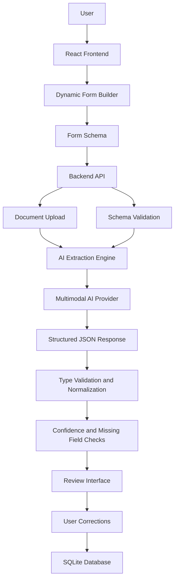

# AI-Powered Form Builder & Intelligent Document Autofill

> Build dynamic forms, upload documents, and automatically populate structured fields using AI-powered document understanding. A schema-driven platform designed to work with any document type without hardcoded field definitions.


---

## Overview

Traditional document autofill systems are usually designed around predefined templates and fixed document structures. They struggle when users need to extract information from different document formats or work with dynamically changing requirements.

**AI-Powered Form Builder & Intelligent Document Autofill** addresses this limitation through a fully schema-driven architecture.

Users can create custom forms, define their own field types and validation rules, upload documents, and automatically extract relevant information into those forms.

The extraction engine dynamically generates its instructions and expected output structure from the user's saved form schema. This allows the same extraction pipeline to support resumes, invoices, application forms, medical intake documents, business records, and other document categories.

### Core Workflow

**Design → Upload → Extract → Validate → Review → Save**

The system combines dynamic form generation, multimodal document understanding, structured data extraction, server-side validation, and human-in-the-loop review.

## Key Features

### 1. Dynamic Schema-Driven Form Builder
- Create forms with custom titles and descriptions.
- Add, edit, and remove fields dynamically.
- Support multiple field types.
- Configure required fields and dropdown options.
- Preview forms while building them.
- Export and import form schemas as JSON.
- No document-specific or business-specific fields hardcoded into the extraction engine.

### 2. Intelligent Document Understanding
- Upload PDF and supported image documents.
- Use multimodal AI to interpret document content.
- Extract information based on the active form schema.
- Generate extraction instructions dynamically.
- Map extracted values to persistent field IDs.
- Return null for missing or uncertain information rather than inventing values.

### 3. Structured Data Extraction
- Generate structured JSON responses.
- Associate extracted values with field IDs.
- Validate extracted values against field types.
- Normalize supported data types.
- Handle dropdown option matching.
- Reject malformed or unexpected model responses.

### 4. Human-in-the-Loop Review
- Display extracted values in an editable form.
- Show confidence indicators for individual fields.
- Highlight missing required values.
- Allow users to correct inaccurate information.
- Save only after user review.

### 5. Reliability and Error Handling
- Server-side request validation.
- File type and size validation.
- AI response parsing and validation.
- Database error handling.
- Missing-field detection.
- Graceful handling of extraction failures.
- Clear API error responses without exposing internal stack traces.

### 6. Form Templates and Persistence
- Save reusable form definitions.
- Reload previously created templates.
- Store reviewed submissions.
- Maintain consistent field identifiers.
- Support schema import and export.

### 7. Interchangeable Backend Architecture
Two backend implementations follow the same API contract:

- Node.js + Express
- Python + FastAPI

The React frontend can work with either implementation.

---

## System Architecture

The application follows a modular architecture with separate frontend, backend, database, and AI extraction responsibilities.



### Architecture Principles

| Principle | Implementation |
|---|---|
| Schema-driven design | Fields are defined dynamically by users |
| Separation of concerns | Frontend, backend, extraction, and persistence are modular |
| Backend interchangeability | Shared API contract |
| Data integrity | Server-side validation |
| Human oversight | User reviews extracted information |
| Privacy-conscious processing | Uploaded files are transient in the current design |
| Extensibility | AI provider and backend implementations can evolve independently |

---

## How It Works

### Step 1: Define a Form

The user creates a form and defines its fields.

Example schema:

```json
{
  "title": "Employee Information",
  "fields": [
    {
      "id": "field_001",
      "label": "Full Name",
      "type": "text",
      "required": true
    },
    {
      "id": "field_002",
      "label": "Email Address",
      "type": "email",
      "required": true
    },
    {
      "id": "field_003",
      "label": "Years of Experience",
      "type": "number",
      "required": false
    }
  ]
}
```

The extraction engine does not depend on these particular fields. They are simply an example of a user-defined schema.

### Step 2: Upload a Document

The user uploads a supported PDF or image.

The backend validates the uploaded file and prepares it for the configured AI provider.

### Step 3: Generate Extraction Instructions

The backend dynamically constructs the extraction prompt using:

- Field IDs
- Field labels
- Field types
- Required-field indicators
- Dropdown options, where applicable

Only the fields belonging to the active form are included in the extraction request.

### Step 4: AI-Powered Extraction

The configured multimodal AI provider interprets the document and returns structured values.

Example:

```json
{
  "values": {
    "field_001": "Jane Doe",
    "field_002": "jane@example.com",
    "field_003": 5
  },
  "confidence": {
    "field_001": "high",
    "field_002": "high",
    "field_003": "medium"
  }
}
```

If information is missing or uncertain, the extraction engine should return null rather than inventing a value.

### Step 5: Validate and Normalize

The backend independently validates the model response.

Examples:

- Invalid numeric values become null.
- Unsupported dropdown values are rejected.
- Unknown field IDs are discarded.
- Missing values are handled explicitly.
- Invalid confidence labels are normalized or rejected.

The model output is never trusted as application data without validation.

### Step 6: Review and Save

The frontend displays the extracted information in the original form.

Users can:

- Review extracted values.
- Edit incorrect information.
- Complete missing required fields.
- Inspect confidence indicators.
- Save the final submission.

---

## Technology Stack

| Layer | Technology | Responsibility |
|---|---|---|
| Frontend | React | User interface |
| Build Tool | Vite | Development and production builds |
| Backend Option A | Node.js, Express | REST API |
| Backend Option B | Python, FastAPI | Alternative REST API |
| Database | SQLite | Forms, fields, submissions |
| Database Library | better-sqlite3 | Node database access |
| Validation | Pydantic / server-side validation | Data integrity |
| AI Integration | Anthropic Claude API | Multimodal document extraction |
| File Handling | Multer | Upload processing |
| API Communication | REST | Frontend-backend communication |

---

## Project Structure

```text
ai-powered-form-builder/
│
├── backend/
│   ├── server.js
│   ├── db.js
│   ├── middleware/
│   ├── services/
│   │   ├── extraction.js
│   │   ├── validation.js
│   │   └── promptBuilder.js
│   ├── routes/
│   │   ├── forms.js
│   │   └── extract.js
│   └── package.json
│
├── backend-python/
│   ├── requirements.txt
│   └── app/
│       ├── main.py
│       ├── db.py
│       ├── schemas.py
│       ├── services/
│       │   ├── extraction.py
│       │   ├── validation.py
│       │   └── prompt_builder.py
│       └── routers/
│           ├── forms.py
│           └── extract.py
│
├── frontend/
│   ├── src/
│   │   ├── components/
│   │   │   ├── FormBuilder.jsx
│   │   │   ├── FieldEditor.jsx
│   │   │   ├── FormRenderer.jsx
│   │   │   ├── DocumentUpload.jsx
│   │   │   └── ReviewForm.jsx
│   │   ├── services/
│   │   ├── App.jsx
│   │   └── main.jsx
│   ├── package.json
│   └── vite.config.js
│
├── .gitignore
└── README.md
```

*The structure above describes the intended modular organization; adjust it to match the actual repository.*

---

## Getting Started

### Prerequisites

- Node.js 18+
- Python 3.10+ (for FastAPI backend)
- npm
- SQLite
- Anthropic API key

### 1. Clone the Repository

```bash
git clone <YOUR_REPOSITORY_URL>
cd ai-powered-form-builder
```

### 2. Configure the Backend

Choose one backend implementation.

**Option A: Node.js + Express**

```bash
cd backend
npm install
```

Create a `.env` file:

```env
ANTHROPIC_API_KEY=your_api_key
PORT=4000
```

Start the server:

```bash
npm start
```

**Option B: Python + FastAPI**

```bash
cd backend-python
python -m venv venv
```

Activate the environment on Windows:

```powershell
.\venv\Scripts\Activate.ps1
```

Install dependencies:

```bash
pip install -r requirements.txt
```

Create a `.env` file with the required configuration:

```env
ANTHROPIC_API_KEY=your_api_key
PORT=4000
```

Start the server:

```bash
uvicorn app.main:app --host 127.0.0.1 --port 4000 --reload
```

### 3. Start the Frontend

Open another terminal:

```bash
cd frontend
npm install
npm run dev
```

Open:

```text
http://localhost:5173
```

The frontend communicates with the selected backend through the configured Vite proxy.

---

## Configuration

| Variable | Required | Description |
|---|---|---|
| ANTHROPIC_API_KEY | Yes | AI provider authentication |
| PORT | No | Backend server port |
| DATABASE_PATH | Optional | SQLite database location, if supported by the implementation |

Never commit API keys, database credentials, or other secrets to version control.

Add `.env` to `.gitignore`.

---

## API Reference

Both backend implementations are designed to expose the same API contract.

| Method | Endpoint | Description |
|---|---|---|
| GET | `/api/forms` | Retrieve saved forms |
| POST | `/api/forms` | Create a form |
| GET | `/api/forms/:id` | Retrieve a form and its fields |
| POST | `/api/forms/:id/submissions` | Save a reviewed submission |
| POST | `/api/extract` | Extract values from an uploaded document |

### Document Extraction Request

**Endpoint:** `POST /api/extract`

**Content-Type:** `multipart/form-data`

Request fields:

- `file`: Uploaded PDF or image.
- `fields`: JSON representation of the active form fields.

### Successful Response

```json
{
  "values": {
    "12": "Jane Doe",
    "13": 4200.5,
    "14": null
  },
  "confidence": {
    "12": "high",
    "13": "medium",
    "14": "low"
  }
}
```

### Error Response

```json
{
  "error": "Unsupported file type. Please upload a supported PDF or image."
}
```

The API should return meaningful HTTP status codes and user-friendly error messages without exposing internal implementation details.

---

## Validation and Error Handling

| Scenario | Expected Behaviour |
|---|---|
| No form fields | Prevent extraction until valid fields exist |
| Missing required information | Keep field empty and highlight it |
| Unsupported document | Reject the upload |
| Corrupted document | Return a controlled error |
| Invalid number | Normalize to null |
| Unknown field ID | Reject or discard the unexpected value |
| AI uncertainty | Return null with low confidence |
| Invalid JSON response | Handle parsing failure safely |
| Database failure | Return a controlled server error |
| AI provider unavailable | Return an extraction failure without losing existing form data |

---

## Security and Privacy Considerations

The application should follow a privacy-conscious approach to document processing.

- Keep AI provider credentials on the backend.
- Validate file extensions, MIME types, and actual file contents.
- Apply upload size limits.
- Avoid storing uploaded documents unnecessarily.
- Avoid logging sensitive document contents.
- Validate AI-generated data before persistence.
- Restrict database access to backend services.
- Sanitize user-provided form labels and descriptions.
- Configure CORS for trusted frontend origins.
- Add authentication and authorization before multi-user deployment.

**Important:** The current design uses transient file processing. This does not automatically guarantee complete privacy: the selected AI provider may process submitted document contents under its own terms and data-handling policies.

---

## Design Decisions and Trade-offs

| Decision | Reason | Trade-off |
|---|---|---|
| Dynamic schemas | Support arbitrary form structures | More complex validation |
| Single extraction request | Consistent structured output | No incremental results |
| Multimodal AI | Understand PDFs and images | Provider cost and dependency |
| SQLite | Simple local persistence | Limited concurrent write throughput |
| Human review | Reduce incorrect submissions | Requires user involvement |
| Transient uploads | Reduce local document retention | Re-upload required for extraction |
| Shared form renderer | Consistent preview and review UI | Requires reusable component design |
| Separate backend implementations | Demonstrate backend flexibility | Additional maintenance |

---

## Roadmap

### Core Improvements
- [ ] Drag-and-drop field reordering.
- [ ] Advanced field validation rules.
- [ ] Support additional document formats.
- [ ] Better extraction error diagnostics.
- [ ] Extraction history and audit logs.
- [ ] Improved confidence calibration.

### AI Improvements
- [ ] Pluggable AI provider architecture.
- [ ] Local OCR integration.
- [ ] Local LLM extraction option.
- [ ] Hybrid document-processing pipeline.
- [ ] Improved semantic dropdown matching.
- [ ] Document-level extraction evaluation.

### Enterprise Improvements
- [ ] User authentication and authorization.
- [ ] Multi-user form ownership.
- [ ] Form versioning.
- [ ] Role-based access control.
- [ ] Database migration support.
- [ ] Background extraction jobs.
- [ ] Rate limiting and monitoring.
- [ ] Automated testing and CI/CD.

---

## Engineering Highlights

This project demonstrates practical implementation of:

- Schema-driven application architecture.
- Dynamic UI generation.
- Multimodal AI integration.
- Prompt engineering and structured outputs.
- Document understanding and information extraction.
- Backend validation and data normalization.
- REST API development.
- SQLite persistence.
- Human-in-the-loop AI workflows.
- Modular backend design.

---

## Contributing

Contributions, suggestions, and improvements are welcome.

1. Fork the repository.
2. Create a feature branch.
3. Implement and test your changes.
4. Submit a pull request with a clear description.

---

## License

This project is available under the MIT License. See the `LICENSE` file for details.

---

**Built with React, Python/Node.js, SQLite, and multimodal AI.**

*Turning unstructured documents into structured, reviewable data.*
